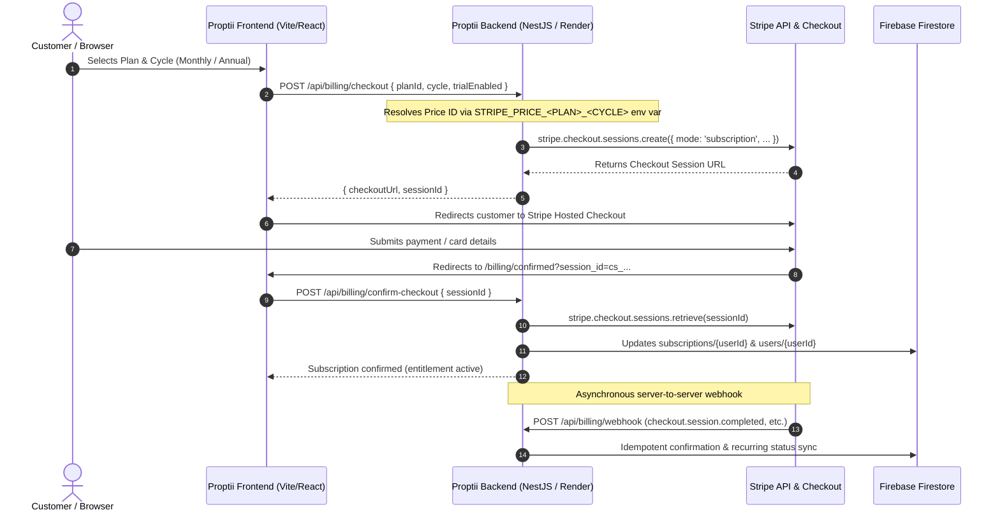

# Stripe Production Setup & DevOps Cutover Runbook

> **Document Type:** Production Runbook / Operations Handover  
> **Target Audience:** DevOps Engineers, Platform Engineers, System Administrators, Tech Lead  
> **Application:** Proptii Platform (Frontend: Vite/React · Backend: NestJS `v2-backend` · Database: Firebase Firestore)  
> **Target Environment:** Production (`sk_live_...` / `pk_live_...`)  
> **Last Updated:** October 2026  

---

## 1. Executive Summary & Architectural Overview

Proptii utilizes **Stripe Billing & Subscriptions** for customer self-service subscriptions across 3 audiences (Renters/Buyers, Landlords, Estate Agents). 

### Payment Flow Architecture



### Critical Security Design Principles in Proptii
1. **Zero Client Price Tampering:** The frontend *never* sends Stripe Price IDs or amounts. The frontend sends `planId` and `cycle`. The backend strictly resolves Price IDs from server-side environment variables (`STRIPE_PRICE_*`).
2. **Strict Plan ID Allowlist:** The backend validates `planId` against a hardcoded set (`renter_pro`, `buyer_pro`, `starter`, `landlord_pro`, `elite`, `independent`, `agent_pro`).
3. **Dual Synchronization (Foreground + Webhook):** The customer is unblocked immediately when returning to `/billing/confirmed`, while webhooks handle renewal, cancellation, and payment failure asynchronously.
4. **Idempotency Safeguard:** All processed Stripe event IDs and session IDs are recorded in Firestore `processedStripeEvents` to prevent duplicate processing.

---

## 2. Pre-Requisites & Live Account Activation

Before carrying out the dashboard tasks in Live mode:

1. **Stripe Account Live Activation:**
   - Ensure the Stripe account is fully activated (Company legal entity verification, registered UK Companies House number, directors ID verification, and connected UK bank account).
   - Toggle the Stripe Dashboard from **Test mode** to **Live mode** (toggle in the top-right corner).
2. **Access & Permissions:**
   - DevOps user must have **Administrator** or **Developer** role in the Stripe team (`dashboard.stripe.com/settings/team`).
3. **Domain Verification & URLs:**
   - Production Frontend URL: `https://proptii.co.uk` (or `https://app.proptii.co.uk`)
   - Production API URL: `https://api.proptii.co.uk` (or Render service URL)

---

## 3. Stripe Dashboard Step-by-Step Configuration

### Step 3.1: Products & Prices Setup (Catalog)

Proptii supports **7 paid subscription plans** across 3 user segments, each having a **Monthly** and **Annual** recurring price in **GBP (£)**.

> [!IMPORTANT]
> **MANDATORY PRODUCT METADATA:**  
> When creating each product in Stripe, you **MUST** add metadata key:  
> `proptii_plan_id` with the exact lowercase identifier (e.g. `renter_pro`).  
> The backend dynamic catalog loader (`billingService.getPlans()`) queries Stripe's active products and matches them using `product.metadata.proptii_plan_id`. If this is omitted, dynamic pricing falls back to static hardcoded values.

#### Plan & Price Matrix

| Product Name | Segment | Plan ID (`proptii_plan_id`) | Cadence | Amount (GBP) | Stripe Price Env Var (Backend) |
|---|---|---|---|---|---|
| **Proptii Renter Pro** | Renter | `renter_pro` | Monthly | **£12.00** / month | `STRIPE_PRICE_RENTER_PRO_MONTHLY` |
| | | | Annual | **£99.00** / year | `STRIPE_PRICE_RENTER_PRO_ANNUAL` |
| **Proptii Buyer Pro** | Buyer | `buyer_pro` | Monthly | **£19.00** / month | `STRIPE_PRICE_BUYER_PRO_MONTHLY` |
| | | | Annual | **£159.00** / year | `STRIPE_PRICE_BUYER_PRO_ANNUAL` |
| **Proptii Starter** | Landlord | `starter` | Monthly | **£29.00** / month | `STRIPE_PRICE_STARTER_MONTHLY` |
| | | | Annual | **£249.00** / year | `STRIPE_PRICE_STARTER_ANNUAL` |
| **Proptii Landlord Pro** | Landlord | `landlord_pro` | Monthly | **£49.00** / month | `STRIPE_PRICE_LANDLORD_PRO_MONTHLY` |
| | | | Annual | **£399.00** / year | `STRIPE_PRICE_LANDLORD_PRO_ANNUAL` |
| **Proptii Elite** | Landlord | `elite` | Monthly | **£99.00** / month | `STRIPE_PRICE_ELITE_MONTHLY` |
| | | | Annual | **£799.00** / year | `STRIPE_PRICE_ELITE_ANNUAL` |
| **Proptii Independent** | Agent | `independent` | Monthly | **£79.00** / month | `STRIPE_PRICE_INDEPENDENT_MONTHLY` |
| | | | Annual | **£750.00** / year | `STRIPE_PRICE_INDEPENDENT_ANNUAL` |
| **Proptii Agent Pro** | Agent | `agent_pro` | Monthly | **£149.00** / month | `STRIPE_PRICE_AGENT_PRO_MONTHLY` |
| | | | Annual | **£1,430.00** / year | `STRIPE_PRICE_AGENT_PRO_ANNUAL` |

*(Note: **Explorer** is free £0 — no Stripe product needed. **Enterprise** is custom quote / offline invoicing).*

#### UI Instructions for Each Product:
1. Navigate to: **Product catalog** (`dashboard.stripe.com/products`).
2. Click **+ Add product**.
3. Enter **Name** (e.g. `Proptii Renter Pro`).
4. Under **Additional options → Metadata**, add:
   - Key: `proptii_plan_id`
   - Value: `renter_pro` (use exact ID from table above)
5. Under **Pricing**:
   - Price 1 (Monthly):
     - Pricing model: **Standard pricing**
     - Price: `12.00`
     - Currency: **GBP (£)**
     - Billing period: **Monthly**
     - Under Additional options → Price metadata: Key `cycle`, Value `monthly`
   - Price 2 (Annual):
     - Click **+ Add another price**
     - Pricing model: **Standard pricing**
     - Price: `99.00`
     - Currency: **GBP (£)**
     - Billing period: **Yearly**
     - Under Additional options → Price metadata: Key `cycle`, Value `annual`
6. Click **Save product**.
7. Note down the generated Price IDs:
   - Monthly price ID (starts with `price_...`)
   - Annual price ID (starts with `price_...`)
8. Repeat for all 7 products.

---

### Step 3.2: Stripe Tax & Business Address Settings (CRITICAL)

> [!CAUTION]
> **PRODUCTION OUTAGE RISK:**  
> In `billing.service.ts` line 401–407:  
> When `STRIPE_SECRET_KEY` starts with `sk_live_`, Proptii automatically passes:  
> `{ automatic_tax: { enabled: true } }` during checkout creation.  
> **If Stripe Tax is not configured with a registered head office business address in Stripe Live mode, all live checkout attempts will fail with a fatal API error (`must have a valid head office address`).**

#### Configuration Steps:
1. Navigate to: **Settings → Tax** (`dashboard.stripe.com/settings/tax`).
2. Click **Set up Stripe Tax** (or **Settings**).
3. **Head office address:** Enter the registered UK business address for Proptii / The Luxcity Global Ltd.
4. **Default tax category:** Select **Software as a service (SaaS) - business to consumer** or **Digital services (general)**.
5. **Tax calculation settings:** Ensure automatic tax calculation is enabled.
6. **Registrations:** Add **United Kingdom (HMRC)** VAT registration if Proptii is VAT registered, or confirm threshold status.

---

### Step 3.3: Customer Billing Portal Configuration

Proptii provides a direct link in the user dashboard (`/dashboard/settings` and Landlord Settings) allowing users to self-manage payment cards, download VAT invoices, or upgrade/cancel plans.

Stripe's Customer Portal will throw an `InvalidRequestError` if it has not been configured and enabled.

#### Configuration Steps:
1. Navigate to: **Settings → Billing → Customer portal** (`dashboard.stripe.com/settings/billing/portal`).
2. Click **Activate** or **Save changes** with the following options:
3. **Features enabled for customers:**
   - [x] **Payment methods:** Allow customers to add, delete, and switch default payment methods.
   - [x] **Invoices:** Allow customers to view billing history and download PDF invoices and receipts.
   - [x] **Customer information:** Allow customers to update their billing email and billing address.
   - [x] **Subscriptions:**
     - Toggle **Allow customers to cancel subscriptions**: Set cancellation behavior to **At end of current billing period**.
     - Toggle **Allow customers to switch plans**: Select all 7 Proptii live products created in Step 3.1 so users can upgrade/downgrade between tiers. Set proration behavior to **Create prorations**.
4. **Business information & links:**
   - **Privacy Policy URL:** `https://proptii.co.uk/privacy`
   - **Terms of Service URL:** `https://proptii.co.uk/terms`
   - **Default return URL:** `https://proptii.co.uk/dashboard/settings`
5. Click **Save changes**.

---

### Step 3.4: Webhook Endpoint Setup

Proptii listens to incoming Stripe events to ensure database consistency if a customer closes the browser before returning to `/billing/confirmed`, as well as for recurring subscription renewals and payment failures.

#### Configuration Steps:
1. Navigate to: **Developers → Webhooks** (`dashboard.stripe.com/webhooks`).
2. Ensure you are in **Live mode**.
3. Click **+ Add an endpoint**.
4. **Endpoint URL:**  
   `https://<YOUR_BACKEND_DOMAIN>/api/billing/webhook`  
   *(e.g., `https://api.proptii.co.uk/api/billing/webhook` or your Render backend URL `https://proptii-v2-backend.onrender.com/api/billing/webhook`)*.
5. **Version:** Latest API version (or default).
6. **Events to send:** Click **Select events** and check **only** the following 5 events:
   - `checkout.session.completed` *(grants initial plan & records customer ID)*
   - `invoice.payment_succeeded` *(renews subscription & extends `currentPeriodEnd`)*
   - `invoice.payment_failed` *(flags subscription as `past_due`)*
   - `customer.subscription.updated` *(handles tier upgrades, cancellations at period end, and trial adjustments)*
   - `customer.subscription.deleted` *(revokes paid entitlements and downgrades to `free`)*
7. Click **Add endpoint**.
8. In the newly created endpoint page, find **Signing secret** and click **Reveal**.
9. Copy the secret (format: `whsec_...`). This is required for `STRIPE_WEBHOOK_SECRET`.

---

### Step 3.5: API Keys Retrieval

1. Navigate to: **Developers → API keys** (`dashboard.stripe.com/apikeys`).
2. Verify you are in **Live mode**.
3. Copy the **Publishable key** (format: `pk_live_...`).
4. Under **Secret key**, click **Reveal live key** and copy it (format: `sk_live_...`).  
   *(Alternative: Create a **Restricted key** with Write permissions for Customers, Checkout Sessions, Customer Portal, and Subscriptions).*

---

### Step 3.6: Branding & Receipts

To ensure checkout and emails carry the official Proptii look:
1. Navigate to: **Settings → Branding** (`dashboard.stripe.com/settings/branding`).
2. Upload:
   - **Icon:** Square Proptii icon (512x512 PNG).
   - **Logo:** Transparent horizontal Proptii logo.
   - **Brand Color:** Proptii primary brand color (`#0f172a` or `#0284c7`).
   - **Accent Color:** Proptii button accent color.
3. Navigate to: **Settings → Emails** (`dashboard.stripe.com/settings/emails`).
   - Enable **Successful payments** email receipt.
   - Enable **Upcoming renewal reminders** (required under UK consumer regulations).

---

## 4. Alternative: Automated Setup via Stripe CLI / Script

If DevOps prefers running a script via the [Stripe CLI](https://stripe.com/docs/stripe-cli) rather than clicking through the dashboard, log in with `stripe login` in live mode and execute:

```bash
#!/usr/bin/env bash
set -euo pipefail

echo "Creating Proptii Live Products and Prices in Stripe..."

# 1. Renter Pro
PROD_RENTER=$(stripe products create \
  --name="Proptii Renter Pro" \
  --metadata[proptii_plan_id]="renter_pro" \
  --description="Unlimited saves, AI fit score, referencing toolkit, and contracts." \
  -d "active=true" --format=JSON | jq -r .id)
PRICE_RENTER_MO=$(stripe prices create --product="$PROD_RENTER" --unit-amount=1200 --currency=gbp --recurring[interval]=month --metadata[cycle]=monthly --format=JSON | jq -r .id)
PRICE_RENTER_YR=$(stripe prices create --product="$PROD_RENTER" --unit-amount=9900 --currency=gbp --recurring[interval]=year --metadata[cycle]=annual --format=JSON | jq -r .id)

# 2. Buyer Pro
PROD_BUYER=$(stripe products create \
  --name="Proptii Buyer Pro" \
  --metadata[proptii_plan_id]="buyer_pro" \
  --description="Mortgage readiness, solicitor recommendations, survey tracker, and timeline." \
  -d "active=true" --format=JSON | jq -r .id)
PRICE_BUYER_MO=$(stripe prices create --product="$PROD_BUYER" --unit-amount=1900 --currency=gbp --recurring[interval]=month --metadata[cycle]=monthly --format=JSON | jq -r .id)
PRICE_BUYER_YR=$(stripe prices create --product="$PROD_BUYER" --unit-amount=15900 --currency=gbp --recurring[interval]=year --metadata[cycle]=annual --format=JSON | jq -r .id)

# 3. Starter
PROD_STARTER=$(stripe products create \
  --name="Proptii Starter" \
  --metadata[proptii_plan_id]="starter" \
  --description="Landlord starter plan for up to 2 properties." \
  -d "active=true" --format=JSON | jq -r .id)
PRICE_STARTER_MO=$(stripe prices create --product="$PROD_STARTER" --unit-amount=2900 --currency=gbp --recurring[interval]=month --metadata[cycle]=monthly --format=JSON | jq -r .id)
PRICE_STARTER_YR=$(stripe prices create --product="$PROD_STARTER" --unit-amount=24900 --currency=gbp --recurring[interval]=year --metadata[cycle]=annual --format=JSON | jq -r .id)

# 4. Landlord Pro
PROD_LANDLORD=$(stripe products create \
  --name="Proptii Landlord Pro" \
  --metadata[proptii_plan_id]="landlord_pro" \
  --description="Landlord pro plan for up to 10 properties." \
  -d "active=true" --format=JSON | jq -r .id)
PRICE_LANDLORD_MO=$(stripe prices create --product="$PROD_LANDLORD" --unit-amount=4900 --currency=gbp --recurring[interval]=month --metadata[cycle]=monthly --format=JSON | jq -r .id)
PRICE_LANDLORD_YR=$(stripe prices create --product="$PROD_LANDLORD" --unit-amount=39900 --currency=gbp --recurring[interval]=year --metadata[cycle]=annual --format=JSON | jq -r .id)

# 5. Elite
PROD_ELITE=$(stripe products create \
  --name="Proptii Elite" \
  --metadata[proptii_plan_id]="elite" \
  --description="Unlimited properties, dedicated manager, bulk referencing." \
  -d "active=true" --format=JSON | jq -r .id)
PRICE_ELITE_MO=$(stripe prices create --product="$PROD_ELITE" --unit-amount=9900 --currency=gbp --recurring[interval]=month --metadata[cycle]=monthly --format=JSON | jq -r .id)
PRICE_ELITE_YR=$(stripe prices create --product="$PROD_ELITE" --unit-amount=79900 --currency=gbp --recurring[interval]=year --metadata[cycle]=annual --format=JSON | jq -r .id)

# 6. Independent
PROD_INDEP=$(stripe products create \
  --name="Proptii Independent" \
  --metadata[proptii_plan_id]="independent" \
  --description="Estate agent plan: up to 50 listings, 20 fit checks/mo." \
  -d "active=true" --format=JSON | jq -r .id)
PRICE_INDEP_MO=$(stripe prices create --product="$PROD_INDEP" --unit-amount=7900 --currency=gbp --recurring[interval]=month --metadata[cycle]=monthly --format=JSON | jq -r .id)
PRICE_INDEP_YR=$(stripe prices create --product="$PROD_INDEP" --unit-amount=75000 --currency=gbp --recurring[interval]=year --metadata[cycle]=annual --format=JSON | jq -r .id)

# 7. Agent Pro
PROD_AGENT=$(stripe products create \
  --name="Proptii Agent Pro" \
  --metadata[proptii_plan_id]="agent_pro" \
  --description="Estate agent plan: unlimited listings, 100 fit checks/mo, 5 team seats." \
  -d "active=true" --format=JSON | jq -r .id)
PRICE_AGENT_MO=$(stripe prices create --product="$PROD_AGENT" --unit-amount=14900 --currency=gbp --recurring[interval]=month --metadata[cycle]=monthly --format=JSON | jq -r .id)
PRICE_AGENT_YR=$(stripe prices create --product="$PROD_AGENT" --unit-amount=143000 --currency=gbp --recurring[interval]=year --metadata[cycle]=annual --format=JSON | jq -r .id)

echo ""
echo "=== Copy the environment variables below into your deployment ==="
echo "STRIPE_PRICE_RENTER_PRO_MONTHLY=$PRICE_RENTER_MO"
echo "STRIPE_PRICE_RENTER_PRO_ANNUAL=$PRICE_RENTER_YR"
echo "STRIPE_PRICE_BUYER_PRO_MONTHLY=$PRICE_BUYER_MO"
echo "STRIPE_PRICE_BUYER_PRO_ANNUAL=$PRICE_BUYER_YR"
echo "STRIPE_PRICE_STARTER_MONTHLY=$PRICE_STARTER_MO"
echo "STRIPE_PRICE_STARTER_ANNUAL=$PRICE_STARTER_YR"
echo "STRIPE_PRICE_LANDLORD_PRO_MONTHLY=$PRICE_LANDLORD_MO"
echo "STRIPE_PRICE_LANDLORD_PRO_ANNUAL=$PRICE_LANDLORD_YR"
echo "STRIPE_PRICE_ELITE_MONTHLY=$PRICE_ELITE_MO"
echo "STRIPE_PRICE_ELITE_ANNUAL=$PRICE_ELITE_YR"
echo "STRIPE_PRICE_INDEPENDENT_MONTHLY=$PRICE_INDEP_MO"
echo "STRIPE_PRICE_INDEPENDENT_ANNUAL=$PRICE_INDEP_YR"
echo "STRIPE_PRICE_AGENT_PRO_MONTHLY=$PRICE_AGENT_MO"
echo "STRIPE_PRICE_AGENT_PRO_ANNUAL=$PRICE_AGENT_YR"
```

---

## 5. Complete Environment Variables Reference

When swapping from test to production, configure the following variables in the respective hosting platforms:

### 5.1 Backend Environment Variables (Render / Host)

Configure these in **Render Dashboard → Environment** for service `v2-backend`:

| Environment Variable | Example Live Value | Notes |
|---|---|---|
| `STRIPE_SECRET_KEY` | `sk_live_51...` | **Secret.** Never commit or log. |
| `STRIPE_WEBHOOK_SECRET` | `whsec_...` | From Webhook endpoint created in Step 3.4. |
| `FRONTEND_URL` | `https://proptii.co.uk` | Used for `success_url` and `cancel_url` redirects. |
| `STRIPE_PRICE_RENTER_PRO_MONTHLY` | `price_1P...` | Monthly price ID for Renter Pro (£12) |
| `STRIPE_PRICE_RENTER_PRO_ANNUAL` | `price_1P...` | Annual price ID for Renter Pro (£99) |
| `STRIPE_PRICE_BUYER_PRO_MONTHLY` | `price_1P...` | Monthly price ID for Buyer Pro (£19) |
| `STRIPE_PRICE_BUYER_PRO_ANNUAL` | `price_1P...` | Annual price ID for Buyer Pro (£159) |
| `STRIPE_PRICE_STARTER_MONTHLY` | `price_1P...` | Monthly price ID for Starter (£29) |
| `STRIPE_PRICE_STARTER_ANNUAL` | `price_1P...` | Annual price ID for Starter (£249) |
| `STRIPE_PRICE_LANDLORD_PRO_MONTHLY` | `price_1P...` | Monthly price ID for Landlord Pro (£49) |
| `STRIPE_PRICE_LANDLORD_PRO_ANNUAL` | `price_1P...` | Annual price ID for Landlord Pro (£399) |
| `STRIPE_PRICE_ELITE_MONTHLY` | `price_1P...` | Monthly price ID for Elite (£99) |
| `STRIPE_PRICE_ELITE_ANNUAL` | `price_1P...` | Annual price ID for Elite (£799) |
| `STRIPE_PRICE_INDEPENDENT_MONTHLY` | `price_1P...` | Monthly price ID for Independent (£79) |
| `STRIPE_PRICE_INDEPENDENT_ANNUAL` | `price_1P...` | Annual price ID for Independent (£750) |
| `STRIPE_PRICE_AGENT_PRO_MONTHLY` | `price_1P...` | Monthly price ID for Agent Pro (£149) |
| `STRIPE_PRICE_AGENT_PRO_ANNUAL` | `price_1P...` | Annual price ID for Agent Pro (£1430) |

### 5.2 Frontend Environment Variables (Vite Build / Static Hosting)

Configure these in the static hosting platform (Cloudflare Pages / Vercel / Netlify / GitHub Actions):

| Environment Variable | Example Live Value | Notes |
|---|---|---|
| `VITE_STRIPE_PUBLISHABLE_KEY` | `pk_live_51...` | **Public.** Bundled into client JS. |
| `VITE_STRIPE_PRICE_*` | `price_...` | (Optional fallback for client-side catalog display). |

---

## 6. DevOps Cutover Execution Checklist

Follow this sequence during the production swap maintenance window:

```
[ ] Phase 1: Pre-Swap Audit
    [ ] 1. Verify Stripe account status is active and verified for live payouts.
    [ ] 2. Confirm all 7 products and 14 prices exist in Stripe Live mode with proptii_plan_id metadata.
    [ ] 3. Confirm Stripe Tax has head office UK address configured.
    [ ] 4. Confirm Customer Portal is active with return URL https://proptii.co.uk/dashboard/settings.
    [ ] 5. Confirm Webhook endpoint is registered with the 5 events.

[ ] Phase 2: Deployment & Configuration Swap
    [ ] 6. Update Render backend environment variables with live STRIPE_SECRET_KEY, STRIPE_WEBHOOK_SECRET, and 14 STRIPE_PRICE_* keys.
    [ ] 7. Trigger Render deployment / service restart.
    [ ] 8. Update Frontend build environment variables with live VITE_STRIPE_PUBLISHABLE_KEY.
    [ ] 9. Deploy production frontend build.

[ ] Phase 3: Post-Deployment Smoke Testing (Live Transaction)
    [ ] 10. Visit https://proptii.co.uk/pricing.
    [ ] 11. Select Renter Pro monthly (£12/mo) and initiate "Pay now".
    [ ] 12. Verify redirect to Stripe Checkout (verify URL starts with https://checkout.stripe.com/c/pay/).
    [ ] 13. Verify business branding, plan name, and automatic tax line (UK VAT if applicable) are rendered.
    [ ] 14. Execute transaction using a real corporate credit/debit card.
    [ ] 15. Verify browser redirects back to https://proptii.co.uk/billing/confirmed?session_id=cs_live_...
    [ ] 16. Verify confirmation animation appears and plan status is "Active".
    [ ] 17. Inspect Stripe Dashboard → Developers → Webhooks → endpoint logs:
            - Confirm checkout.session.completed returned HTTP 200 OK.
    [ ] 18. Inspect Firebase Firestore:
            - Collection subscriptions/{userId}: verify planId='renter_pro', status='active', stripeCustomerId='cus_...', stripeSubscriptionId='sub_...'.
            - Collection users/{userId}: verify isSubscribed=true, subscriptionTier='renter_pro'.
    [ ] 19. Navigate to Dashboard Settings → "Manage Billing":
            - Confirm Stripe Billing Portal opens cleanly without errors.
    [ ] 20. Immediate Refund / Cleanup:
            - In Stripe Dashboard → Payments: refund the test transaction immediately to reverse the charge.
```

---

## 7. Troubleshooting & Rollback Plan

### Common Failure Modes & Quick Fixes

| Symptom | Root Cause | Immediate Remediation |
|---|---|---|
| Checkout throws 500: `must have a valid head office address` | Stripe Tax is enabled (`automatic_tax: true`) in live mode, but no address is set in Stripe Dashboard. | Go to `dashboard.stripe.com/settings/tax`, enter the company's registered UK head office address, and save. |
| Checkout throws 400: `No Stripe price configured for plan...` | The backend env var `STRIPE_PRICE_<PLAN>_<CYCLE>` is missing or misspelled in Render. | Verify the exact spelling of the env var on Render against the plan ID table in §3.1. Re-deploy. |
| Returning customer stuck in loading loop on `/billing/confirmed` | Stripe session verification failed or database write timed out. | Check backend logs for `[BillingService] confirmCheckoutSession`. Ensure Firebase Admin credentials in production have write access to `subscriptions` and `processedStripeEvents`. |
| Webhook endpoint returns HTTP 400 | `STRIPE_WEBHOOK_SECRET` does not match the live endpoint signing secret, or body parsing corrupted raw payload. | Ensure the raw signing secret (`whsec_...`) is copied from the live endpoint. Do not modify `main.ts` raw body middleware. |
| Customer portal throws 400 `Customer portal is not configured` | Portal was not activated in Stripe Dashboard. | Go to `dashboard.stripe.com/settings/billing/portal`, click "Save changes" / activate. |

### Emergency Rollback
If live payments must be temporarily suspended:
1. Revert Render environment variables to previous test keys (`sk_test_...`, `whsec_test_...`).
2. Alternatively, set complimentary access emails in `COMPLIMENTARY_EMAIL_DOMAINS` to allow internal staff continued full access without Stripe charges during incident resolution.
3. Check Render logs via `render logs` or Render UI for real-time tracebacks.
